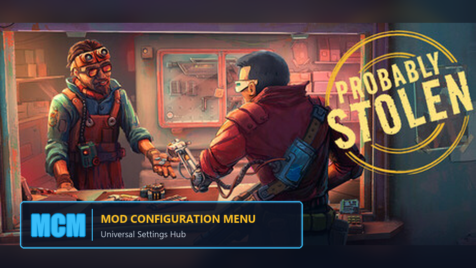

# ProbablyMCM - Mod Configuration Menu for Probably Stolen



A unified in-game settings hub and developer configuration framework for all mods in **Probably Stolen**.

---

## 🎮 Features for Players

* **In-Game Access:** Accessible via the Pause Menu (`Esc`), the Main Menu, or the `F10` hotkey.
* **Configurable Hotkey:** Open the MCM anytime with `F10` (can be customized or disabled in MCM settings).
* **Responsive 2-Column Interface:**
  * **Left Column:** Mod list featuring real-time search, settings count badges `(XX)`, and smart text truncation (`...`) with full-title tooltips.
  * **Right Column:** Clean, section-organized settings including toggles, sliders, number inputs, dropdowns, buttons, and hotkey pickers.
* **Interactive KeyBind Dialog:** Click any keybind setting to open a compact pop-up modal. Simply press any key or combination (`Ctrl`, `Alt`, `Shift` + Key) to bind. Press `Delete` to unbind (`None`), or `Esc` to cancel.
* **Zero-Setup Compatibility:** Existing mods using the game's standard `ModConfig` are automatically detected, organized, and rendered without requiring any mod updates.
* **Multi-Language Support:** Fully localized into 9 languages: English, Russian, Simplified Chinese, Traditional Chinese, German, Japanese, French, Spanish, and Polish.
* **Instant Persistence & Reset:** All changes are automatically saved in real time. A "Reset to Defaults" button is always available to revert settings.

---

## 🛠️ Quick Guide for Modders (Fluent API)

> 📘 **Full Developer Documentation (English & 中文):** Read [Documentation.md](Documentation.md) for complete details on Zero-Dependency mapping, live callbacks, and localization.

To create a configuration menu for your mod, add a reference to `ProbablyMCM.dll` in your project and initialize your settings:

```csharp
using ProbablyMCM.API;
using UnityEngine;

public class MyAwesomeMod : IMod
{
    public void Init(ModManifest manifest)
    {
        var settings = ModSettings.For("my_mod_id", "My Awesome Mod");

        // Section 1: Gameplay
        settings.Section("Gameplay");
        
        // Toggle (Checkbox)
        settings.AddToggle("auto_organize", "Auto Sort Inventory", defaultValue: true,
            tooltip: "Automatically sort items when opening containers",
            onChanged: (val) => Debug.Log($"Auto-sort: {val}"));

        // Slider (HasRange)
        settings.AddSlider("speed_multiplier", "Movement Speed Multiplier", defaultValue: 1.5f, min: 0.5f, max: 5.0f, step: 0.1f,
            tooltip: "Adjust character movement speed in the store");

        // Number Input (Int / Float)
        settings.AddInt("max_capacity", "Storage Capacity", defaultValue: 50, min: 10, max: 200);

        // Section 2: Controls
        settings.Section("Controls");
        
        // Interactive KeyBind Dialog (Popup modal with Ctrl/Alt/Shift support)
        settings.AddKeyBind("open_menu_key", "Quick Access Hotkey", defaultKey: KeyCode.F7,
            tooltip: "Click to rebind. Press Delete to clear.");

        // Section 3: Visuals
        settings.Section("Interface");
        settings.AddDropdown("theme", "Color Theme", defaultValue: "Dark",
            options: new[] { "Dark", "Light", "High Contrast" });

        // Action Button
        settings.AddButton("clean_cache", "Wipe Cache", () =>
        {
            Debug.Log("Cache successfully cleared!");
        });
    }

    public void OnEnable() {}
    public void OnDisable() {}
}
```

### Reading Values in Mod Logic:

```csharp
var settings = ModSettings.For("my_mod_id");

bool autoSort = settings.Get<bool>("auto_organize");
float speed = settings.Get<float>("speed_multiplier");
KeyCode key = settings.Get<KeyCode>("open_menu_key");
```

---

## 📁 File Structure

```
Mods/ProbablyMCM/
├── manifest.xml           # Game modloader manifest
├── ProbablyMCM.dll        # Compiled binary
├── preview.png            # Workshop / Repo banner
├── README.md              # English documentation & overview
├── Documentation.md       # Comprehensive developer guide (English & 中文)
├── Localization/          # 9 language translation files (*.csv)
└── ...
```

Configurations are stored in the game's standard path:
`%AppData%/../LocalLow/Salty Panda Studios/Probably Stolen/ModConfigs/<ModId>.json`

---

## 👤 Author
Developed by **Raul Moreau** ([GafarovMaxim](https://github.com/GafarovMaxim)).
Distributed under the MIT License.
